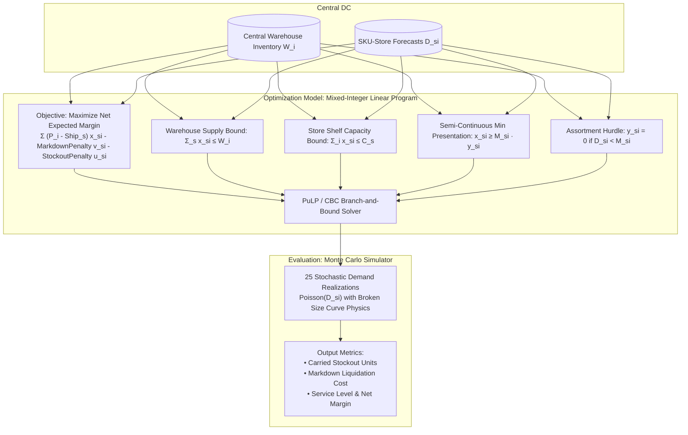

# Inventory Allocation & Markdown Optimization 📦🏷️

A mathematical programming and simulation framework for enterprise retail supply chain networks. Formulates store-level multi-SKU inventory replenishment as a **Mixed-Integer Linear Program (MILP)** solved via PuLP and CBC, incorporating store shelf capacities, minimum presentation stock constraints, tiered shipping logistics, and markdown liquidation decay.

---

## 🚀 Key Benchmark Results

Evaluated across **25 retail stores** (Flagship, High-Street, Mall, Outlet), **100 SKUs**, and **52,714 units** of central warehouse inventory against a 25-trial stochastic Monte Carlo demand realization simulation:

| Metric | Proportional Baseline | Greedy Heuristic | MILP (Optimal) | Impact vs. Baseline |
| :--- | :---: | :---: | :---: | :---: |
| **Carried Stock-Out Units** | 7,713 | 3,864 | **3,091** | **-59.9% Stockout Reduction** |
| **Carried Stock-Out Rate** | 14.96% | 8.32% | **6.85%** | **-8.11 pp drop** |
| **Markdown Liquidation Cost** | $260,004 | $146,140 | **$204,188** | **-21.5% Markdown Savings** |
| **Broken Assortment Displays** | 197 violations | 0 | **0 violations** | **100% Display Integrity** |
| **Solver Status / Runtime** | Rule-based (0.01s) | Heuristic (0.05s) | **Optimal (31.0s)** | Exact Integer Solution |

---

## 🏛️ Mathematical Formulation



### Mathematical Model:
$$\max_{\mathbf{x}, \mathbf{y}, \mathbf{u}, \mathbf{v}} \sum_{s \in S} \sum_{i \in I} \left[ (P_i - C_s^{\text{ship}}) x_{s, i} - (P_i - P_i^{\text{mdown}} + c_i^{\text{hold}}) v_{s, i} - c_{s, i}^{\text{stockout}} u_{s, i} \right]$$

**Subject to:**
1. **Warehouse Supply Bound:** $\sum_{s \in S} x_{s, i} \le W_i \quad \forall i \in I$
2. **Store Capacity Bound:** $\sum_{i \in I} x_{s, i} \le C_s \quad \forall s \in S$
3. **Minimum Presentation Stock:** $x_{s, i} \ge M_{s, i} \cdot y_{s, i} \quad \text{and} \quad x_{s, i} \le U_{s, i} \cdot y_{s, i} \quad \forall s, i$
---

## 📂 Repository Structure

```
inventory-allocation-optimization/
├── config/
│   └── config.yaml               # Network topology, store tiers, economic penalties
├── data/
│   ├── raw/                      # Parquet datasets (stores, skus, forecasts, warehouse)
│   └── sample_inventory_data.py  # Synthetic retail network generator
├── src/
│   ├── models/
│   │   ├── milp_optimizer.py     # PuLP MILP formulation with CBC solver
│   │   └── baseline_heuristics.py # Proportional allocation & greedy heuristic
│   └── simulation/
│       └── demand_simulator.py   # Monte Carlo demand realization & P&L engine
├── scripts/
│   └── run_allocation.py         # End-to-end benchmark execution script
├── tests/
│   ├── test_milp.py              # Unit tests for integer constraints & bounds
│   ├── test_heuristics.py        # Unit tests for baseline proportional & greedy
│   └── test_simulation.py        # Unit tests for Monte Carlo simulation engine
├── pytest.ini
└── README.md
```

---

## ⚡ Quickstart

### 1. Setup Environment
```bash
python -m venv .venv
source .venv/bin/activate
pip install -r requirements.txt
```

### 2. Run Test Suite
```bash
pytest tests/ -v
```

### 3. Run Optimization Benchmark
```bash
python scripts/run_allocation.py
```

